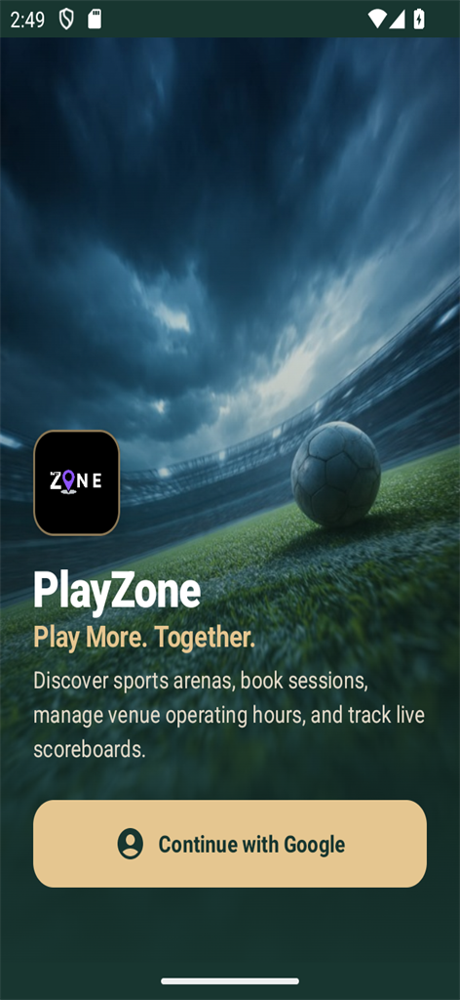
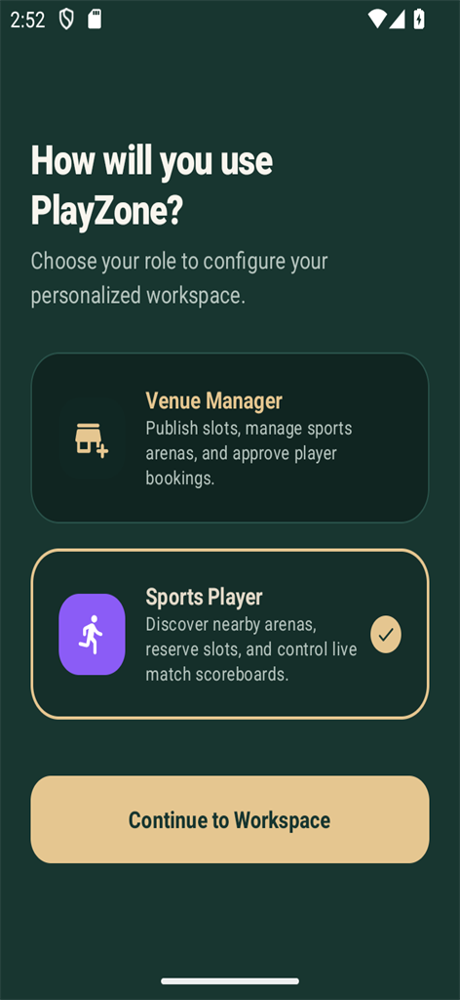
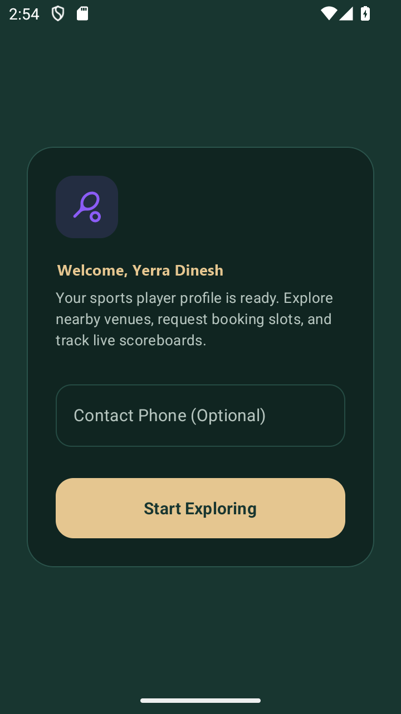
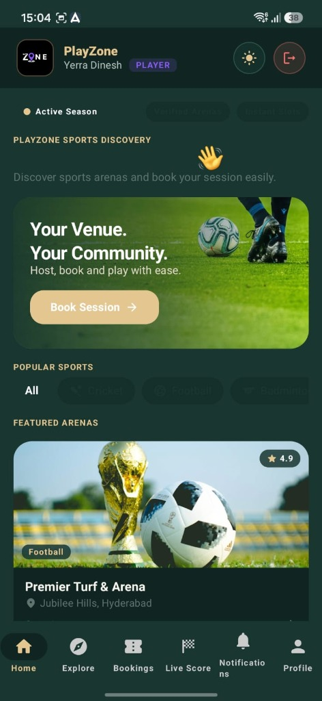
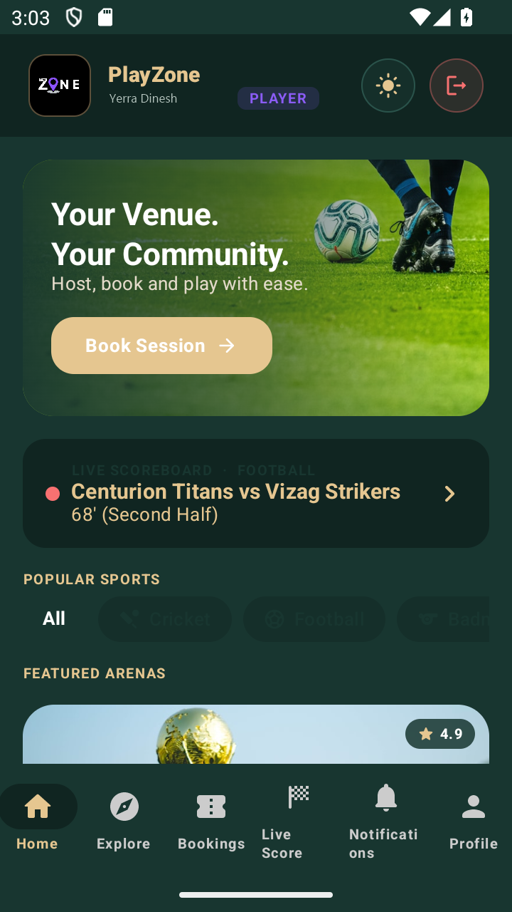
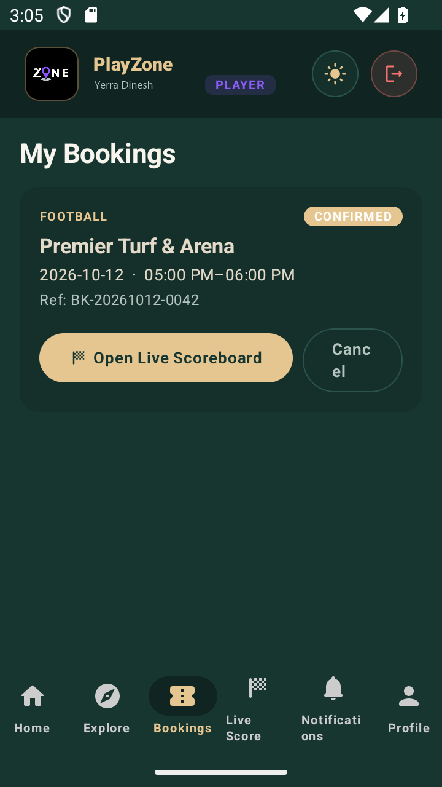
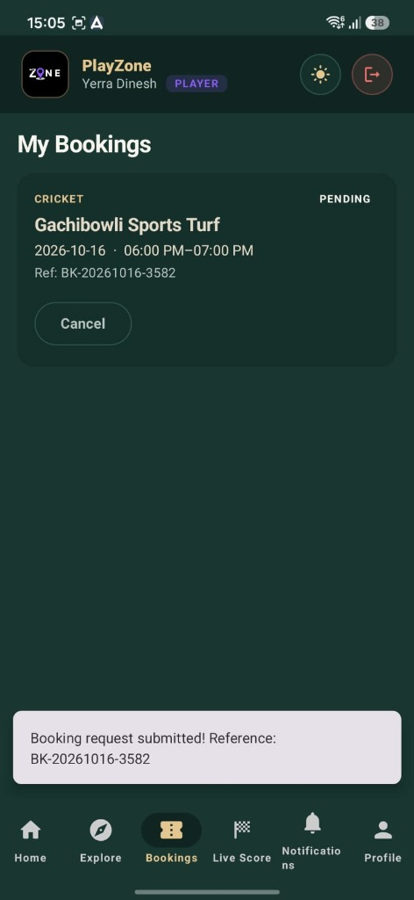
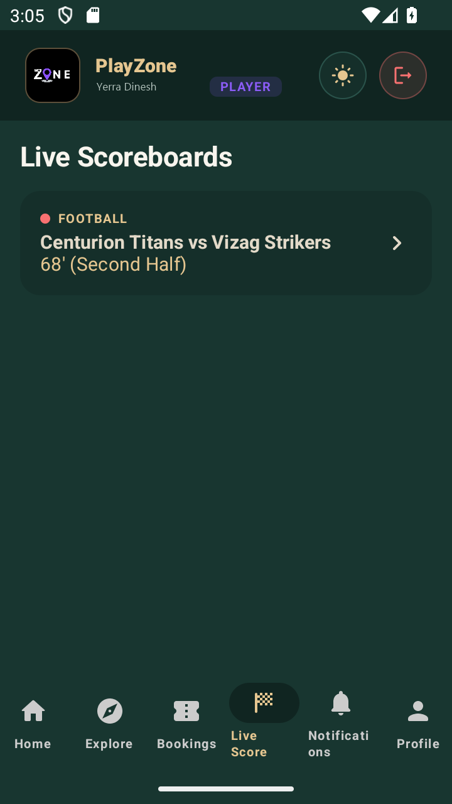
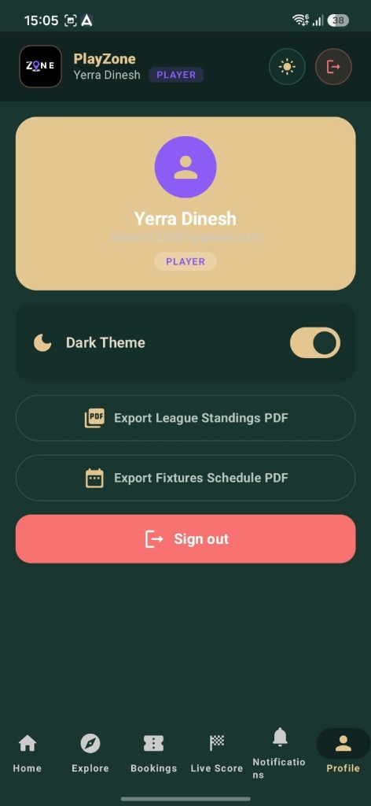

# PlayZone — Sports Venue Discovery, Booking & Live Match Manager

PlayZone is a native Android application built for sports enthusiasts and facility operators. It connects venue managers (who operate turfs, courts, arenas, and manage live match scoreboards) directly with players (who discover venues, reserve slots, track bookings, and control live matches).

---

## App Previews

<p align="center">
  
  
  
</p>

<p align="center">
  
  
  
</p>

<p align="center">
  
  
  
</p>

---

## Core Features

### 1. Dual-Role Architecture
* **Player Workspace**:
  * Discover arenas, turfs, and courts with real photos, distance, and ratings.
  * Filter by sport (Football, Cricket, Badminton, Basketball, Tennis, Volleyball), date, price, and amenities.
  * Reserve available time slots or request custom slots with team/squad names.
  * Track booking status (Pending, Confirmed, Completed, Cancelled) with unique references.
  * In-app notifications for confirmation, conflict alerts, and reminders.
* **Venue Manager Workspace**:
  * Manage multiple sports arenas, operating hours, amenities, and equipment.
  * Review booking requests: Approve confirmed bookings or decline with specific reasons.
  * Conflict protection: Automatic overlap prevention across identical time slots.
  * Add custom slots, block maintenance hours, and inspect venue schedules.

### 2. Live Match Scoreboards & Multi-Device Sync
* Built-in sport-tailored scoreboards:
  * **Football**: Goals, team names, match timer, kicking events.
  * **Cricket**: Runs, wickets, overs, and match summary.
  * **Basketball & Badminton**: Points, quarters, and sets.
* **On-the-Fly Customization**: Authorized scorers (booked player or manager) can rename squads/teams directly from the scorecard.
* **Dual Real-Time Sync**:
  * **LAN UDP P2P Broadcast**: Broadcasts scores instantly over local Wi-Fi without internet latency.
  * **Cloud Sync (Firestore)**: Keeps remote spectators and offline sessions synchronized.

### 3. League Management & PDF Export
* Tournament bracket engine supporting single-elimination and round-robin structures.
* Standings tables and fixture schedule export directly to formatted PDF files.
* Biometric authentication support and theme toggle (Dark / Light mode).

---

## Architecture & Tech Stack

* **Language**: Kotlin 2.3+ (Java 21/23 target)
* **UI**: 100% Jetpack Compose with Material 3 Design
* **Local Database**: Room DB (`Ps22Database`) with reactive Kotlin Flows
* **Concurrency**: Kotlin Coroutines (`Flow`, `StateFlow`, `SupervisorJob`)
* **Background Tasks**: WorkManager for scheduled session reminders
* **Remote Sync**: Firebase Firestore & LAN UDP socket multicasting
* **Dependency Injection & Architecture**: Clean Architecture with Repository pattern

---

## Getting Started

### Prerequisites
* Android Studio Ladybug (2024.2+) or newer
* Android SDK 35 (minSdk 26, targetSdk 35)
* JDK 17 or higher

### Local Setup
1. Clone the repository:
   ```bash
   git clone https://github.com/yerradinesh06/playzone_androidproject.git
   cd playzone_androidproject
   ```

2. Configure local SDK:
   Copy `local.properties.example` to `local.properties`:
   ```bash
   cp local.properties.example local.properties
   ```
   Set your Android SDK path in `local.properties` (e.g. `sdk.dir=C:\\Users\\<YourName>\\AppData\\Local\\Android\\Sdk`).

3. Configure Firebase (Optional for Google Sign-In & Remote Sync):
   * Create a project in the [Firebase Console](https://console.firebase.google.com/).
   * Download your `google-services.json` and place it inside the `app/` directory (see `app/google-services.json.example` for reference).

4. Build and run:
   ```bash
   ./gradlew assembleDebug
   ```

---

## Database Schema Overview

| Entity Table | Purpose |
|---|---|
| `users` | User credentials, display name, phone/squad tag, and role (PLAYER / VENUE_MANAGER). |
| `venues` | Sports facilities, operating hours, coordinates, supported sports, pricing. |
| `sessions` | Individual hourly time slots, capacity, status (AVAILABLE, BOOKED, BLOCKED). |
| `bookings` | Booking requests, player information, squad names, timestamps, approval status. |
| `match_scoreboards` | Real-time score state, team A/B names, sport type, and controller ID. |
| `scoreboard_events` | Match timeline events (goals, team updates, kickoff). |
| `notifications` | User notifications for status updates and reminders. |

---

## Build & Test Commands

Run the following commands from the project root:

```powershell
# Execute unit tests
./gradlew.bat :app:testDebugUnitTest

# Assemble debug APK
./gradlew.bat :app:assembleDebug
```

---

## License

This project is developed for academic and personal portfolio demonstration. All rights reserved.
